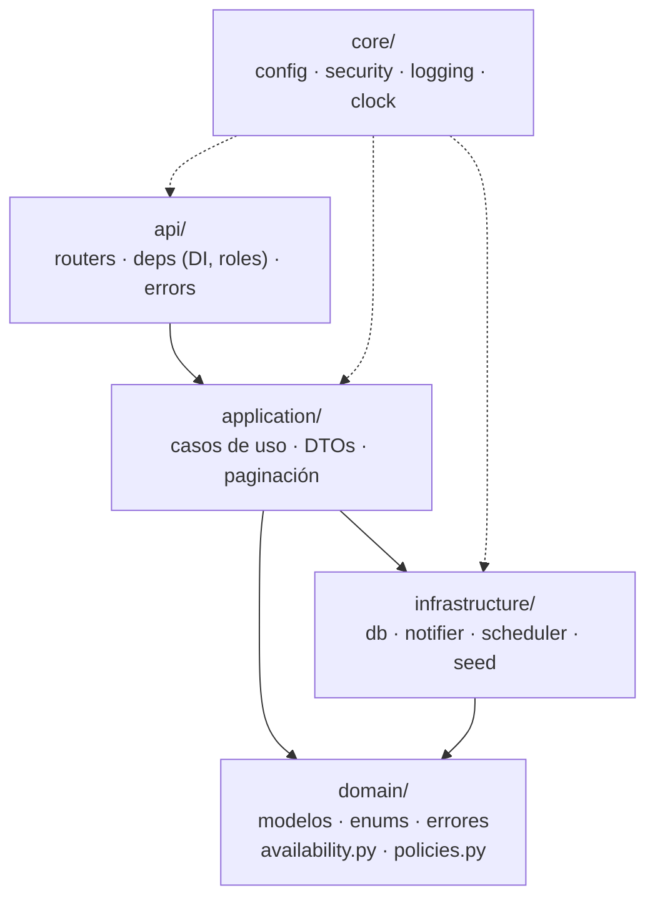
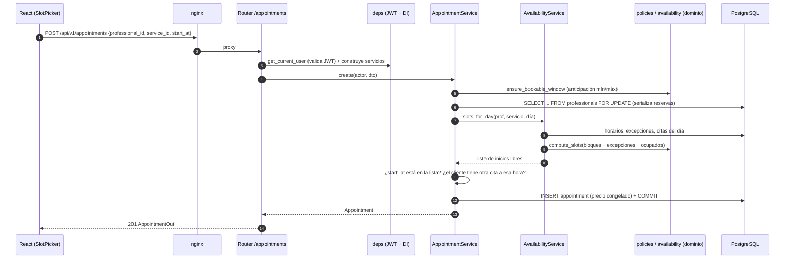

# Arquitectura

## Visión general

El sistema es un monorepo con dos aplicaciones desplegables:

- **backend/**: API REST en FastAPI organizada en capas (Clean Architecture pragmática).
- **frontend/**: SPA en React + TypeScript servida por nginx, que además hace de proxy inverso hacia `/api`.

En producción (docker-compose) hay tres contenedores: `db` (PostgreSQL 16), `backend` y `frontend`.

## Capas del backend

| Capa | Responsabilidad | Depende de |
|---|---|---|
| `domain` | Reglas de negocio puras: cálculo de huecos libres, políticas de reserva/cancelación, excepciones de dominio, entidades. | Nada externo (salvo el mapeo ORM declarativo de entidades). |
| `application` | Orquesta casos de uso: reservar, reprogramar, cancelar, KPIs, recordatorios. Aplica alcance por rol. | `domain`, puertos (`Clock`, `Notifier`). |
| `infrastructure` | Detalles técnicos: motor SQLAlchemy, notificador simulado, APScheduler, datos semilla. | `domain`, `application`. |
| `api` | HTTP: validación de entrada (Pydantic), autenticación JWT, autorización por rol, traducción de errores a ProblemDetails. | `application`. |
| `core` | Configuración (12-factor), seguridad, logging JSON, reloj. | — |

`app/main.py::create_app()` es el **composition root**: construye motor, fábrica de sesiones, reloj y notificador, y los guarda en `app.state`. Las dependencias de FastAPI (`api/deps.py`) crean los servicios por petición. Gracias a esto, las pruebas construyen la app con **SQLite en memoria**, un **reloj fijo** y un **notificador falso** sin parches globales.

## Flujo de una petición: reservar una cita

Si una regla falla, el servicio lanza una excepción de dominio (`BusinessRuleError` → 422, `ConflictError` → 409, `NotFoundError` → 404…) y `api/errors.py` la convierte en `application/problem+json` con `request_id` para correlacionar con los logs.

## Decisiones clave

1. **Validar la reserva contra la misma función que muestra la disponibilidad.** Una cita solo se acepta si su inicio está en `slots_for_day`. Así nunca hay dos reglas distintas (una para mostrar y otra para validar) que puedan divergir. Ver [ADR 0001](decisiones/0001-calculo-disponibilidad.md).
2. **Hora local "naive" del negocio.** Todas las fechas se guardan sin zona en la hora de `America/Lima`. Ver [ADR 0002](decisiones/0002-zona-horaria.md).
3. **Recordatorios idempotentes con restricción única.** Ver [ADR 0003](decisiones/0003-recordatorios-idempotentes.md).
4. **Entidades ORM como modelo de dominio.** Evita una doble capa de mapeo en un sistema mediano; la lógica crítica (disponibilidad y políticas) sí está en funciones puras sin ORM.
5. **Baja lógica de servicios.** Eliminar un servicio rompería el historial de citas; se desactiva.
6. **404 en lugar de 403 para citas ajenas.** No revela la existencia de recursos de otros usuarios.

## Seguridad

- Contraseñas con **bcrypt** (costo 12). Mismo mensaje para usuario inexistente y clave incorrecta (evita enumeración).
- **JWT HS256** con expiración; el registro público siempre crea rol `cliente`.
- Autorización en dos niveles: **por endpoint** (`require_roles`) y **por alcance de datos** (`_scope` filtra citas por cliente/profesional).
- Ordenamiento solo por campos de una **lista blanca**.
- Contenedores con **usuario no root** y nginx con cabeceras de seguridad básicas.

## Observabilidad

- Logs JSON en una línea (`ts`, `level`, `logger`, `msg`, `request_id`, campos extra).
- Middleware que asigna/propaga `X-Request-ID` y registra método, ruta, estado y latencia.
- `/health` verifica la conexión a la base de datos.

## Frontend

- `api/client.ts` centraliza `fetch`: agrega el token, normaliza errores ProblemDetails en `ApiError` (con errores por campo) y limpia la sesión ante un 401.
- `auth/AuthContext.tsx` mantiene el usuario; `RequireAuth` protege rutas por rol.
- `hooks/useAsync.ts` maneja carga/error/datos e ignora respuestas obsoletas al cambiar filtros.
- Las páginas se cargan con `React.lazy` (code splitting).
- El calendario semanal posiciona eventos con `lib/calendar.ts::positionEvent` (lógica probada con Vitest).
