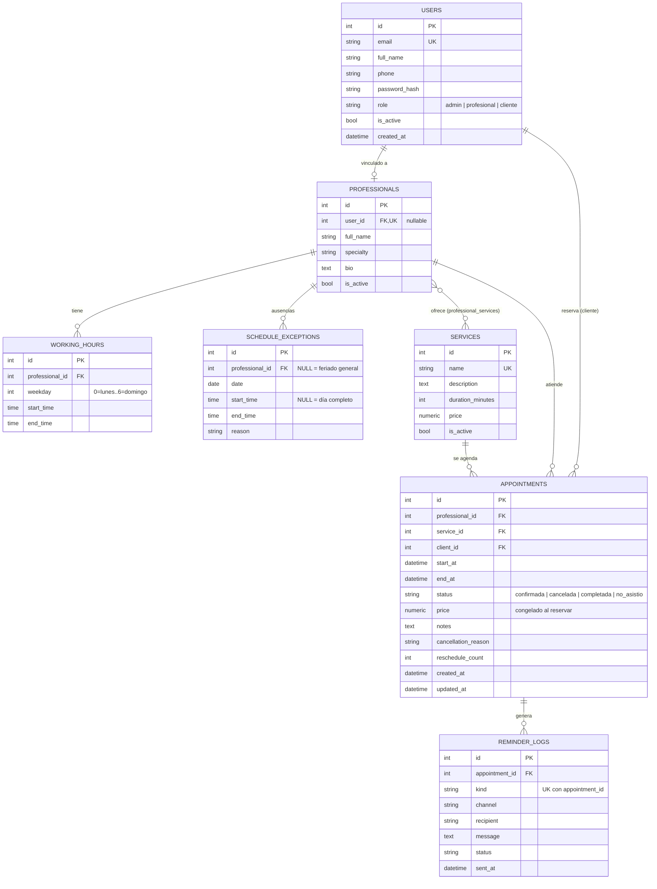
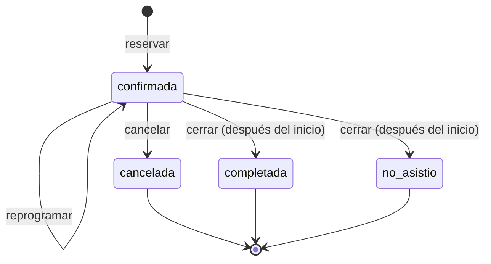

# Modelo de datos

## Tablas

| Tabla | Propósito | Reglas relevantes |
|---|---|---|
| `users` | Cuentas de acceso de los tres roles. | Email único (índice). Contraseña solo como hash bcrypt. |
| `services` | Catálogo con duración y precio. | Nombre único. Baja lógica con `is_active`. |
| `professionals` | Personas que atienden. | `user_id` opcional y único: permite que el profesional inicie sesión y gestione su agenda. |
| `professional_services` | Relación N:M profesional–servicio. | La disponibilidad exige que el profesional ofrezca el servicio. |
| `working_hours` | Bloques semanales de atención. | `CHECK weekday BETWEEN 0 AND 6`, `CHECK end_time > start_time`; la API rechaza bloques que se cruzan en el mismo día. |
| `schedule_exceptions` | Feriados y ausencias. | `professional_id` nulo = afecta a todos. `start/end` nulos = día completo. |
| `appointments` | Citas. | `CHECK end_at > start_at`. Índice compuesto `(professional_id, start_at)` para consultar la agenda de un día. El precio se copia del servicio al reservar. |
| `reminder_logs` | Bitácora de recordatorios enviados. | `UNIQUE (appointment_id, kind)`: como máximo un recordatorio de cada tipo por cita (idempotencia). |

## Estados de una cita

Las citas `cancelada` liberan el horario; `completada` y `no_asistio` siguen ocupándolo para no reabrir huecos en el historial.

## Migraciones

- `backend/alembic/versions/0001_esquema_inicial.py` crea el esquema completo.
- Una prueba (`tests/test_migrations.py`) aplica la migración sobre SQLite y verifica que las tablas y columnas coincidan con los modelos, y que el `downgrade` funcione.
